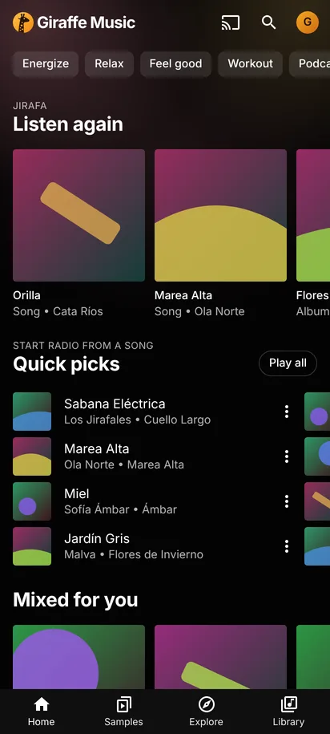
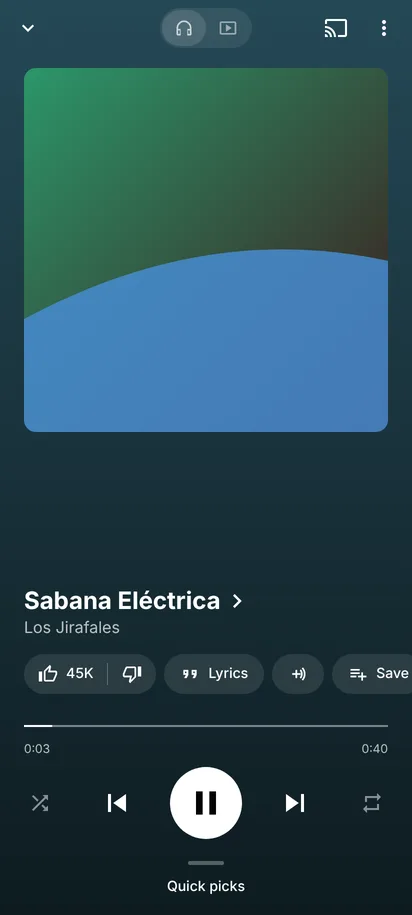
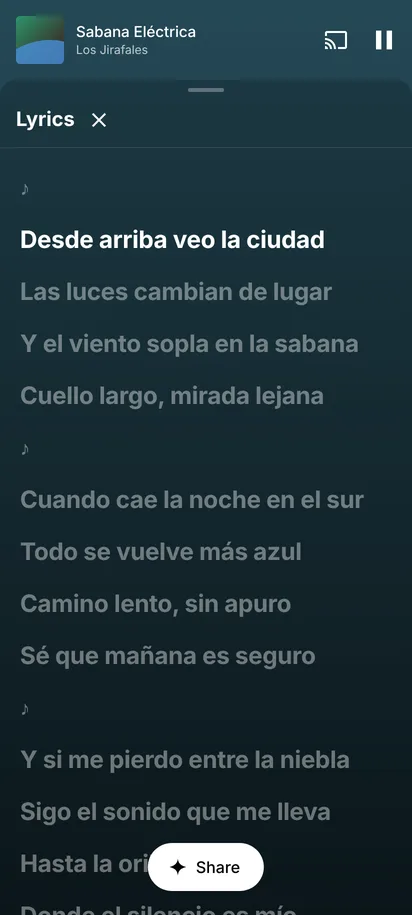
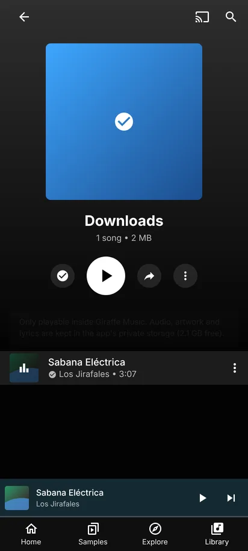

  
  <h1>Giraffe Music</h1>
  
<strong>YouTube Music para Android, con su misma interfaz. Sin anuncios y cuidando la batería.</strong>

  

    
    
    
  

  

    <a href="../../releases/latest"><b>Descargar</b></a> ·
    <a href="#qué-tiene">Qué tiene</a> ·
    <a href="#instalar">Instalar</a> ·
    <a href="mobile/README.md">Detalles técnicos</a>
  

  
  
  
  

## Qué tiene

- **La interfaz de YouTube Music móvil:** Inicio con *Quick picks* y *Listen again*,
  Samples, Explore, Library, búsqueda, álbumes, artistas y playlists.
- **Sin anuncios.** Ninguno.
- **Tu cuenta de YouTube:** tus playlists, Liked Music, historial y recomendaciones.
  Los me gusta y las playlists que edites se guardan en tu cuenta.
- **Reproductor completo:** cambio entre canción y video, cola, letras sincronizadas,
  relacionados, aleatorio y repetir. Sigue sonando con la pantalla bloqueada.
- **Descargas:** la canción, su carátula y su letra. Solo se pueden escuchar dentro de la app.
- **Cuida la batería:** audio decodificado por hardware, nada se actualiza en pantalla si
  no lo estás viendo y el video se suelta al bloquear el teléfono.
- **Extras:** ecualizador y Dolby Atmos (si tu celular los tiene), normalización de volumen,
  importar playlists de Spotify y *Hace un año escuchabas…*
- **Se actualiza sola:** cuando sale una versión nueva, la app la descarga y la instala.

## Instalar

1. Entrá en [**Releases**](../../releases/latest).
2. Descargá **`giraffe-music-arm64-v8a.apk`**, que sirve para casi todos los celulares
   actuales. Si no te instala, usá **`giraffe-music-universal.apk`**.
3. Abrilo y aceptá *instalar apps de esta fuente*.

> Si tenías una versión de prueba anterior a la 0.3.0, desinstalala primero: estaba
> firmada con otra llave.

## Cómo está hecha

Giraffe Music está construida sobre **[ytm-rs](https://github.com/grapedjuice/ytm-rs)**,
un cliente de YouTube Music para escritorio escrito en Rust. El núcleo en Rust de ytm-rs
(búsquedas, cuenta, audio, SponsorBlock) corre dentro de la app. Encima tiene una interfaz
nueva que imita la de YouTube Music y un reproductor nativo de Android (Media3/ExoPlayer).

- [`mobile/`](mobile/README.md) — la app de Android: código, cómo compilarla y cómo publicar versiones.
- [`src/`](src) — el núcleo de ytm-rs que comparte con la versión de escritorio.
- [`YTM-RS.md`](YTM-RS.md) — el README original de ytm-rs.

## Aviso

Giraffe Music es un cliente no oficial. No tiene relación con YouTube ni con Google, ni
está respaldado por ellos. Proyecto escolar, distribuido bajo la licencia
[GPL-3.0](LICENSE), igual que ytm-rs.
